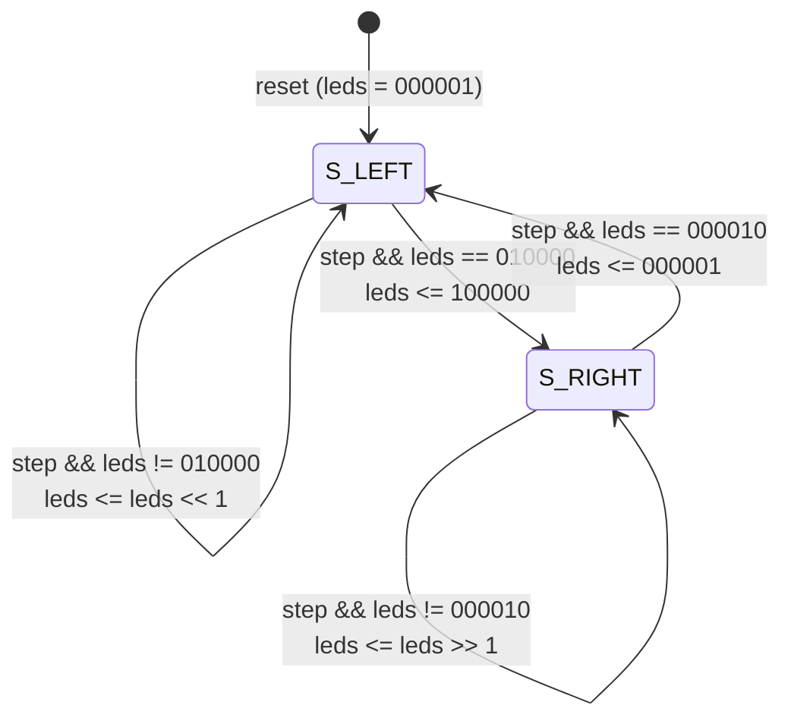

:::callout title="Recommended Primary Sources"
- **Companion app**: `apps/0004-flip-flops-registers-fsm/` (`make -C apps/0004-flip-flops-registers-fsm clean all`)
- **Video reference**: [Episode 4: How a Chip Remembers: I Built Memory from Scratch, One Bit at a Time](https://www.youtube.com/watch?v=rFxJn-Mws8s)
- **Simulation & waveforms**: [Icarus Verilog Documentation](https://steveicarus.github.io/iverilog/) and [Surfer Waveform Viewer](https://surfer-project.org/)
- **Course references**: [Lesson 3](0003-8bit-ripple-carry-adder.md), [Glossary](../reference/GLOSSARY.md), and [Toolchain Cheat Sheet](../reference/toolchain-cheatsheet.md)
:::

## 1. How Silicon Remembers: The D Flip-Flop & Clock Edges

Everything we built in [Lesson 2](0002-half-adder-and-waveforms.md) and [Lesson 3](0003-8bit-ripple-carry-adder.md) had **zero memory**. Release button `s1`, and the adder's output changes immediately; nothing inside the FPGA remembers what the previous sum was. A 6502 CPU cannot work that way—it needs an Accumulator (`A`), Index registers (`X` and `Y`), a Program Counter (`PC`), and a state machine that knows which instruction cycle comes next.

In FPGA silicon, state lives inside **D flip-flops** (`DFF` primitives). Unlike a combinational wire (`assign`), a D flip-flop ignores changes on its `d` input almost all the time. Only at the exact instant of a rising clock edge (`posedge clk`, `0 -> 1`) does it snapshot `d` and hold that bit steady on `q` until the next rising edge.

```mermaid caption="Figure 4.1: Combinational next-state logic feeding a clocked D flip-flop"
flowchart LR
  D["Next-State Logic<br/>(Combinational LUTs)"] -->|"d (sampled on posedge clk)"| FF["D Flip-Flop<br/>(DFFRE)"]
  CLK["Global clk (27 MHz)"] --> FF
  RST["reset"] --> FF
  EN["enable / load"] --> FF
  FF -->|"q (steady between ticks)"| OUT["Output / Feedback"]
```

Every sequential module in our 6502 computer follows that exact feedback loop: combinational logic computes what the *next* state should be, and D flip-flops lock that value in on `posedge clk`.

## 2. Non-Blocking (`<=`) vs. Blocking (`=`) Assignments

Inside a clocked `always @(posedge clk)` block, Verilog gives you two assignment operators: `=` (**blocking**) and `<=` (**non-blocking**). Picking the wrong one is the classic beginner bug in hardware design, because `=` acts like software while `<=` models parallel flip-flops.

Consider swapping two 8-bit registers `reg_x` and `reg_y` on a single clock edge:

```verilog caption="Non-blocking <= evaluates all right-hand sides before updating any register"
always @(posedge clk) begin
    reg_x <= reg_y;
    reg_y <= reg_x;
end
```

- With **non-blocking `<=`**, both right-hand sides (`reg_y` and `reg_x`) are sampled simultaneously using their **pre-tick** values. On `posedge clk`, `reg_x` receives the old `reg_y`, and `reg_y` receives the old `reg_x`—a clean swap with zero temporary variables.
- If you instead wrote `reg_x = reg_y; reg_y = reg_x;` using **blocking `=`**, line 1 would overwrite `reg_x` immediately, and line 2 would read the *new* `reg_x`—clobbering `reg_x`'s original value so both registers end up holding `reg_y`!

:::callout-warn title="The Golden Assignment Rule in Verilog"
1. Inside clocked `always @(posedge clk)` blocks, **always use non-blocking `<=`**.
2. Inside `assign` statements, combinational `always @(*)` blocks, and testbench stimulus sequences (`initial` / `task`), **use blocking `=`**.
Never mix `=` and `<=` on the same signal, and never drive the same `reg` from two separate `always` blocks.
:::

## 3. Building Blocks: `register.v` and `counter.v`

Our first two reusable sequential modules wrap Gowin flip-flops with **synchronous reset** and a **clock enable** (`load` or `enable`). Notice the `if (reset) ... else if (load)` priority: when `reset` is high on a rising clock edge, the register clears to `0` even if `load` or `enable` is asserted at the same time.

### An 8-Bit Loadable Register (`register.v`)

```verilog caption="apps/0004-flip-flops-registers-fsm/register.v"
`timescale 1ns / 1ps

module register (
    input  wire       clk,
    input  wire       reset,
    input  wire       load,
    input  wire [7:0] d,
    output reg  [7:0] q = 8'd0
);
    always @(posedge clk) begin
        if (reset) begin
            q <= 8'd0;
        end else if (load) begin
            q <= d;
        end
    end
endmodule
```

- Notice there is no `else` branch after `else if (load)`: when `reset == 0` and `load == 0`, the flip-flop simply holds its previous value. (In combinational `always @(*)` blocks, omitting `else` infers a dreaded latch; inside `always @(posedge clk)`, it maps cleanly to the flip-flop's dedicated hardware clock-enable pin!)
- Synthesising `register.v` alone with `yosys` produces **8 `DFFRE` cells** (`D` flip-flop with synchronous `R`eset and clock `E`nable) and **0 LUTs**—every bit maps straight into hard Gowin flip-flop silicon.

### An 8-Bit Enable Counter (`counter.v`)

```verilog caption="apps/0004-flip-flops-registers-fsm/counter.v"
`timescale 1ns / 1ps

module counter (
    input  wire       clk,
    input  wire       reset,
    input  wire       enable,
    output reg  [7:0] count = 8'd0
);
    always @(posedge clk) begin
        if (reset) begin
            count <= 8'd0;
        end else if (enable) begin
            count <= count + 8'd1;
        end
    end
endmodule
```

- `count <= count + 8'd1;` feeds the current 8-bit register value into an 8-bit incrementer and captures the sum back into `count` on each enabled `posedge clk`.
- Because `count` is 8 bits wide, adding `1` to `8'hFF` (`255`) wraps cleanly back to `8'h00`—verified explicitly in `counter_tb.v`.

## 4. The Single-Clock Design Rule & `timer.v`

In [Lesson 1](0001-fpga-toolchain-environment.md), we blinked an LED using `counter[24]`. A tempting shortcut for beginners is to wire a slow bit like `counter[21]` into another module's `clk` port (`always @(posedge slow_clk)`). **Resist that temptation.**

Inside the Tang Nano 20K, Pin `4` feeds a dedicated low-skew **global clock network** engineered so the rising edge reaches every flip-flop across the die at almost the exact same picosecond. If you route a regular flip-flop output (`slow_clk`) through general LUT routing as a clock, different flip-flops see the edge at slightly different times (**clock skew**), inviting subtle hold-time bugs that pass simulation and fail unpredictably on real silicon{{sidenote:We will enforce this single-clock discipline across our entire 6502 core: the CPU runs on the fast FPGA clock, paced by a single-tick <code>step</code> enable signal rather than a divided clock.}}.

Instead of dividing the clock, we keep **every flip-flop on the 27 MHz `clk`** and build `timer.v` to emit a **single-cycle `tick` enable pulse** once every `PERIOD` cycles:

$$f_{\text{tick}} = \frac{27{,}000{,}000\text{ Hz}}{2{,}700{,}000} = 10\text{ Hz} \quad (\text{1 step every } 100\text{ ms})$$

```verilog caption="apps/0004-flip-flops-registers-fsm/timer.v"
`timescale 1ns / 1ps

module timer #(
    parameter integer PERIOD = 2700000
) (
    input  wire clk,
    input  wire reset,
    output reg  tick = 1'b0
);
    localparam [24:0] MAX_COUNT = PERIOD - 1;
    reg [24:0] count = 25'd0;

    always @(posedge clk) begin
        if (reset) begin
            count <= 25'd0;
            tick  <= 1'b0;
        end else if (count == MAX_COUNT) begin
            count <= 25'd0;
            tick  <= 1'b1;
        end else begin
            count <= count + 25'd1;
            tick  <= 1'b0;
        end
    end
endmodule
```

- `parameter integer PERIOD = 2700000` gives us a smooth 10 Hz visual step on hardware, while `timer_tb.v` and `top_tb.v` override `.PERIOD(4)` so simulations finish in nanoseconds.
- `tick` stays `0` for `PERIOD - 1` cycles and pulses `1` for **exactly one clock cycle**, so downstream modules gated by `if (enable)` or `if (step)` advance once every 100 ms while still obeying the single global clock.

## 5. Your First Finite State Machine (`scanner.v`) & Wiring `top.v`

A **Finite State Machine (FSM)** is a sequential circuit that holds an explicit `state` register and decides both its outputs and its next `state` using a `case (state)` block. This exact `localparam` + `case (state)` pattern is how we will build the 6502's instruction fetch-and-execute sequencer in Lesson 12.

To see an FSM in action on our six LEDs, `scanner.v` implements a classic bouncing "Knight Rider" scanner with two states (`S_LEFT` and `S_RIGHT`):



### Block 1: State Constants and Synchronous Reset (`scanner.v`)

```verilog caption="Declaring FSM states with localparam in scanner.v"
`timescale 1ns / 1ps

module scanner (
    input  wire       clk,
    input  wire       reset,
    input  wire       step,
    output reg  [5:0] leds = 6'b000001
);
    localparam S_LEFT  = 1'b0;
    localparam S_RIGHT = 1'b1;

    reg state = S_LEFT;

    always @(posedge clk) begin
        if (reset) begin
            leds  <= 6'b000001;
            state <= S_LEFT;
```

- `localparam` defines synthesis-time named constants scoped cleanly inside `scanner` (preventing magic `0` and `1` numbers in `case` branches).

### Block 2: Look-Ahead Bounce Logic Using Non-Blocking `<=`

```verilog caption="Shifting leds and flipping direction on the pre-tick position"
        end else if (step) begin
            case (state)
                S_LEFT: begin
                    leds <= {leds[4:0], 1'b0};
                    if (leds == 6'b010000) begin
                        state <= S_RIGHT;
                    end
                end
                S_RIGHT: begin
                    leds <= {1'b0, leds[5:1]};
                    if (leds == 6'b000010) begin
                        state <= S_LEFT;
                    end
                end
                default: begin
                    leds  <= 6'b000001;
                    state <= S_LEFT;
                end
            endcase
        end
    end
endmodule
```

- Look closely at `if (leds == 6'b010000) state <= S_RIGHT;`! Why test `6'b010000` (bit 4) instead of `6'b100000` (bit 5)? Because `<=` samples `leds` **before** the edge updates it: on the clock tick where `leds` shifts from `010000` into the final spot `100000`, `leds` is still `010000`, so `state` flips to `S_RIGHT` on that exact same tick—ready to bounce straight back to `010000` on the next step without pausing or shifting the bit off the edge!
- Always include a `default:` branch in `case (state)` so any unexpected state recovers cleanly instead of locking up.

### Full `scanner.v` Module

```verilog caption="apps/0004-flip-flops-registers-fsm/scanner.v"
`timescale 1ns / 1ps

module scanner (
    input  wire       clk,
    input  wire       reset,
    input  wire       step,
    output reg  [5:0] leds = 6'b000001
);
    localparam S_LEFT  = 1'b0;
    localparam S_RIGHT = 1'b1;

    reg state = S_LEFT;

    always @(posedge clk) begin
        if (reset) begin
            leds  <= 6'b000001;
            state <= S_LEFT;
        end else if (step) begin
            case (state)
                S_LEFT: begin
                    leds <= {leds[4:0], 1'b0};
                    if (leds == 6'b010000) begin
                        state <= S_RIGHT;
                    end
                end
                S_RIGHT: begin
                    leds <= {1'b0, leds[5:1]};
                    if (leds == 6'b000010) begin
                        state <= S_LEFT;
                    end
                end
                default: begin
                    leds  <= 6'b000001;
                    state <= S_LEFT;
                end
            endcase
        end
    end
endmodule
```

### Wiring Everything Together in `top.v`

Our `top` module puts all four ideas on one global clock: `timer` fires a 10 Hz `tick`, feeding both `counter` and `scanner` in lockstep. Button `s1` drives synchronous `reset`{{sidenote:Push-buttons are asynchronous to the 27 MHz clock; for a simple reset demo this works well, and in Lesson 17 we will pass button inputs through a 2-flip-flop synchroniser so a CPU reset never hits metastability.}}, and button `s2` multiplexes the 6 LEDs between the bouncing scanner (`s2 = 0`) and the live 6-bit binary counter (`s2 = 1`).

### Complete `top.v` Listing

```verilog caption="apps/0004-flip-flops-registers-fsm/top.v"
`timescale 1ns / 1ps

module top #(
    parameter integer TIMER_PERIOD = 2700000
) (
    input  wire       clk,
    input  wire       s1,
    input  wire       s2,
    output wire [5:0] led
);
    wire reset = s1;
    wire tick;
    wire [7:0] count;
    wire [5:0] scan_leds;

    timer #(
        .PERIOD(TIMER_PERIOD)
    ) u_timer (
        .clk(clk),
        .reset(reset),
        .tick(tick)
    );

    counter u_counter (
        .clk(clk),
        .reset(reset),
        .enable(tick),
        .count(count)
    );

    scanner u_scanner (
        .clk(clk),
        .reset(reset),
        .step(tick),
        .leds(scan_leds)
    );

    wire [5:0] display = s2 ? count[5:0] : scan_leds;
    assign led = ~display;
endmodule
```

Running `make -C apps/0004-flip-flops-registers-fsm stats` shows Yosys synthesises `top` into **39 flip-flops** (`26 DFFR`, `12 DFFRE`, `1 DFFSE`), `31 ALU` cells for the timer and counter incrementers, `57` LUTs (`LUT1`–`LUT4`), and `29` `MUX2_LUT*` cells—all meeting 27 MHz timing in `nextpnr-himbaechel`.

---

:::exercise id="ex-0004" title="Interactive Lab: Clocked Register, Non-Blocking Swap & FSM Enable" badge="Skill Practice • Sequential Verilog"
Complete the clocked sensitivity list, reset priority branch, non-blocking register swap, and enable-gated FSM check:

```verilog
always @({{blank:posedge clk|Rising edge of clk|???|11}}) begin
    if (reset) begin
        q <= {{blank:8'd0||8'h00||0|8-bit zero reset value|???|4}};
    end else if (load) begin
        q <= d;
    end
end

always @(posedge clk) begin
    reg_x {{blank:<=|Non-blocking assignment|???|2}} reg_y;
    reg_y {{blank:<=|Non-blocking assignment|???|2}} reg_x;
end

if (reset) begin
    state <= S_LEFT;
end else if ({{blank:step|Single-cycle enable signal|???|4}}) begin
    leds <= {leds[4:0], 1'b0};
end
```

:::prompts
hint: "Use `posedge clk` for synchronous edges, `8'd0` for reset, `<=` for both swap lines so pre-tick values are sampled, and `step` as the single-clock enable gate."
success: "Clean sequential Verilog! That exact `posedge clk` + `<=` + `step` + `case (state)` pattern is the backbone of our 6502 CPU sequencer."
:::
:::

:::quiz id="quiz-0004" title="Retrieval Practice: Flip-Flops, Non-Blocking <= & Single-Clock Design" badge="3 Questions • Equal-Length Options"
- question: "What happens when you write `reg_x = reg_y; reg_y = reg_x;` using blocking `=` inside `always @(posedge clk)`?"
  wrong_hint: "Trace line 1 then line 2 in sequential order as blocking `=` executes."
  options:
    - letter: "A"
      text: "Both registers exchange their pre-edge values cleanly during the same rising clock edge."
      correct: false
      explain: "Exchanging values without a temporary variable requires non-blocking `<=`, not blocking `=`."
    - letter: "B"
      text: "Yosys rejects the module with a syntax error because blocking operators require assign."
      correct: false
      explain: "`=` is legal inside `always` blocks—it just evaluates sequentially rather than in parallel."
    - letter: "C"
      text: "Both registers end up holding the original value of reg_y after one clock."
      correct: true
      explain: "Correct: line 1 overwrites `reg_x` with `reg_y` immediately, so line 2 copies that same `reg_y` back into `reg_y`."
    - letter: "D"
      text: "The synthesis tool inserts a hidden temporary LUT register between both flip-flop chains."
      correct: false
      explain: "Synthesis faithfully turns `reg_x = reg_y; reg_y = reg_x;` into two flip-flops both wired to `reg_y`."
- question: "Why does `top.v` use a 1-clock `tick` enable pulse from `timer` instead of `always @(posedge tick)`?"
  wrong_hint: "Think about FPGA global clock routing networks versus regular LUT routing."
  options:
    - letter: "A"
      text: "Keeping every flip-flop on the global 27 MHz clock avoids skew and timing hazards."
      correct: true
      explain: "Correct: routing every flip-flop on the dedicated global clock tree with single-cycle enable pulses avoids logic-derived clock skew."
    - letter: "B"
      text: "Gowin GW2AR-18 FPGAs physically only allow one clock signal per Verilog top source file."
      correct: false
      explain: "Gowin chips support multiple clocks (we will use a PLL clock for HDMI in Lesson 6), though unnecessary divided clocks cause skew."
    - letter: "C"
      text: "Enable pulses automatically double the maximum toggle rate of every physical onboard user LED."
      correct: false
      explain: "Enable pulses slow down when registers update; they do not double LED toggle rates."
    - letter: "D"
      text: "Icarus Verilog cannot simulate designs containing more than one clocked always block per module."
      correct: false
      explain: "Icarus Verilog happily simulates multiple clocks; the single-clock rule protects real FPGA timing."
- question: "In `scanner.v`, why does `if (leds == 6'b010000) state <= S_RIGHT;` fire one step before `leds` hits `6'b100000`?"
  wrong_hint: "Remember which value of `leds` is visible on the right-hand side during `posedge clk`."
  options:
    - letter: "A"
      text: "Because bit shifts inside a case statement always skip over the most-significant wire position."
      correct: false
      explain: "Bit `5` (`6'b100000`) is not skipped—it is loaded on that exact clock edge."
    - letter: "B"
      text: "Because the timer emits two consecutive enable ticks whenever the scanner nears an endpoint."
      correct: false
      explain: "`timer` always emits a single 1-clock `tick` pulse regardless of scanner state."
    - letter: "C"
      text: "Because active-low LED inversion shifts the six-bit output vector left by one extra pin."
      correct: false
      explain: "Bitwise inversion `~display` flips polarity without shifting any bit positions."
    - letter: "D"
      text: "Because non-blocking assignments compare the pre-tick register values while scheduling the final shift simultaneously."
      correct: true
      explain: "Correct: when `leds` is `010000` before the edge, that tick simultaneously shifts `leds` into `100000` and flips `state` to `S_RIGHT`."
:::

:::verify id="verify-0004" title="Verification Lab: Sequential Simulation, Surfer Waveforms & Live Board Demo" badge="Simulation & Hardware Gate"
Run all five sequential testbenches, inspect the synthesised flip-flop stats, examine `scanner.vcd` and `timer.vcd` in Surfer, and flash the Tang Nano 20K:

```bash caption="Simulate, inspect stats and waveforms, and flash Lesson 4"
make -C apps/0004-flip-flops-registers-fsm clean all
make -C apps/0004-flip-flops-registers-fsm stats
make -C apps/0004-flip-flops-registers-fsm wave
make -C apps/0004-flip-flops-registers-fsm flash
```

- [ ] `make -C apps/0004-flip-flops-registers-fsm clean all` passes with zero `iverilog -Wall` warnings and prints `PASS:` for `register`, `counter`, `timer`, `scanner`, and `top`.
- [ ] `make stats` shows `register` synthesises to `8 DFFRE` cells (`0` LUTs) and `top` uses `39` flip-flops (`26 DFFR`, `12 DFFRE`, `1 DFFSE`).
- [ ] In Surfer (`make wave` and `make wave-timer`), confirm `tick` is high for exactly one 10 ns clock period every 4 edges, and `scanner` bounces cleanly from `000001` up to `100000` and back to `000001`.
- [ ] On the flashed Tang Nano 20K:
  - With neither button pressed, a single bright LED sweeps left and right across all 6 LEDs at 10 steps per second.
  - Hold `S2`: `led[5:0]` switches live to the 6-bit binary counter ticking upward in lockstep.
  - Hold `S1`: both the scanner and counter synchronously reset (`led[0]` lit on scanner mode, all LEDs off in `S2` counter mode) and resume cleanly when released.
:::

:::teacher-prompt title="Part 1 Complete — Preview Lesson 5 (VGA Raster Timing)"
Congratulations—you have wrapped up **Part 1: Digital Logic & FPGA Fundamentals**! Once you have watched the scanner and counter run on your Tang Nano 20K, ask any questions about non-blocking assignments, `DFFRE` flip-flops, or FSM design—or say **"ready for Lesson 5"** to kick off Part 2 by building the 640×480@60 Hz VGA raster counters for our 6502 computer's video card.
:::
